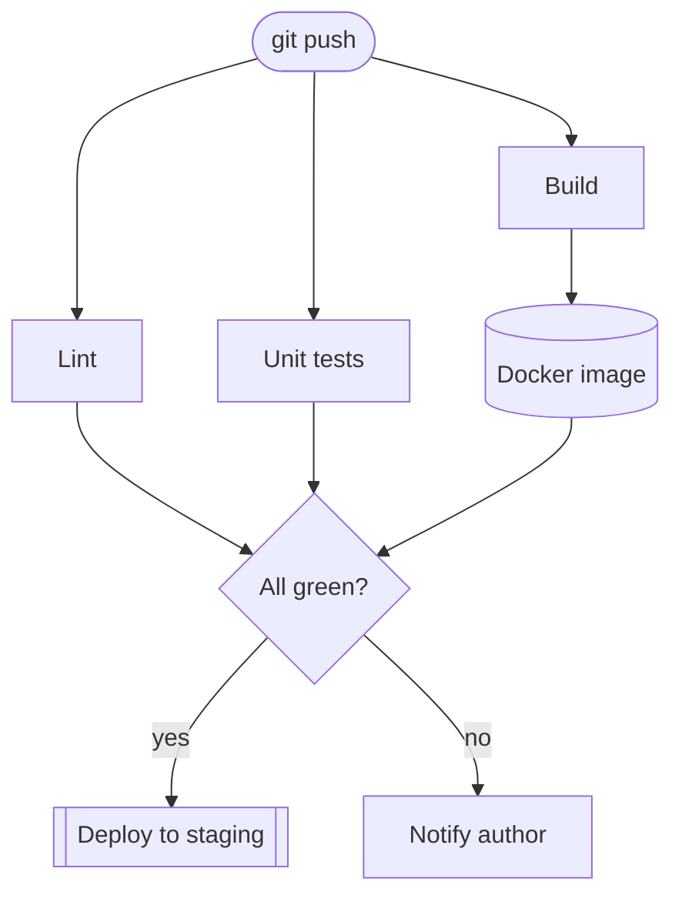
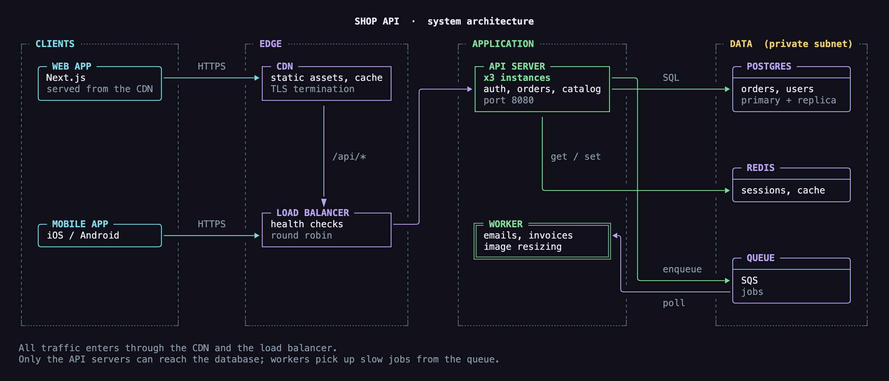
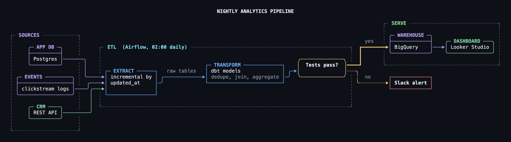
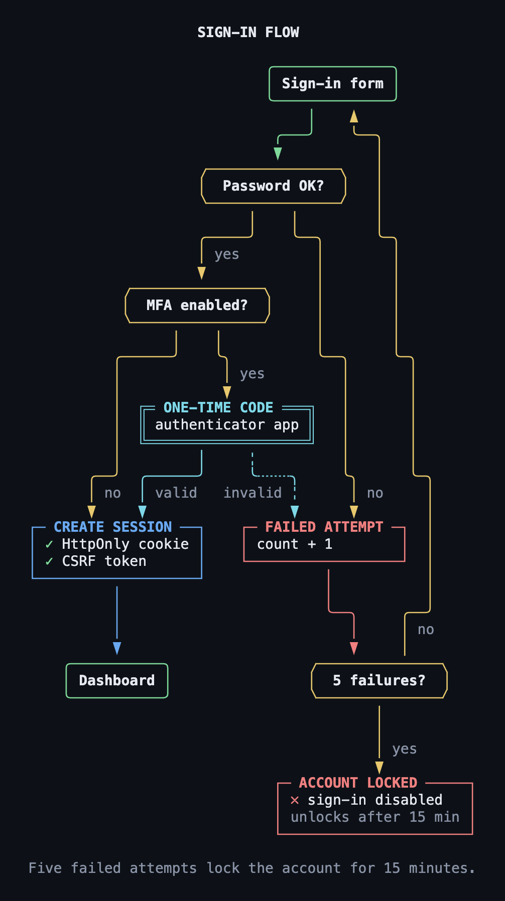
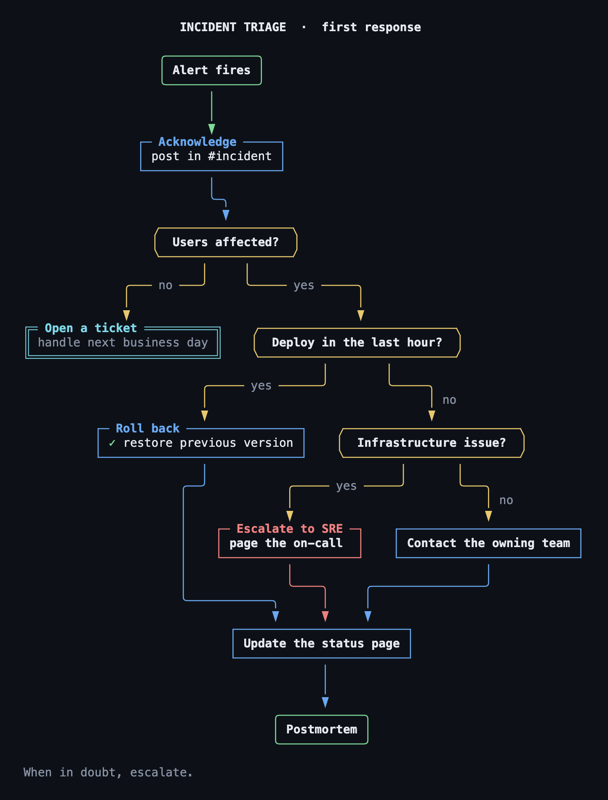
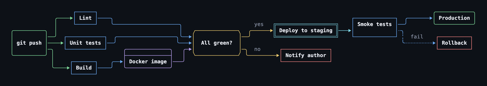

# tui-mermaid-diagram

[](https://github.com/tuki0918/tui-mermaid-diagram/actions/workflows/test.yml)

Render Mermaid `flowchart` and `block-beta` diagrams as TUI-style box drawings for the terminal: rounded boxes, orthogonal connectors and 24-bit color. Output can also be plain text, HTML, SVG or PNG. No dependencies; Node.js 18+.

> [!NOTE]
> This is a preview release (v0.x). Supported syntax and output may change between versions.



```text
                ╭──────────╮
                │ git push │
                ╰──────────╯
                   │  │ │
       ╭───────────╯  │ ╰────────────╮
       ▼              ▼              ▼
   ┌──────┐    ┌────────────┐    ┌───────┐
   │ Lint │    │ Unit tests │    │ Build │
   └──────┘    └────────────┘    └───────┘
       │              │              │
       ╰─────╮       ╭╯         ╭────╯
             │       │          ▼
             │       │  ╭──────────────╮
             │       │  ├──────────────┤
             │       │  │ Docker image │
             │       │  ╰──────────────╯
             │       │          │
             ╰────╮  ╰╮  ╭──────╯
                  ▼   ▼  ▼
              ╱──────────────╲
              │  All green?  │
              ╲──────────────╱
                   │    │
          ╭─ yes ──╯    ╰── no ──╮
          │                      │
          ▼                      ▼
╔═══════════════════╗    ┌───────────────┐
║ Deploy to staging ║    │ Notify author │
╚═══════════════════╝    └───────────────┘
```

## Install

```bash
npm install -g tui-mermaid-diagram
```

Or run it without installing:

```bash
npx tui-mermaid-diagram diagram.mmd
```

## Usage

```bash
tui-mermaid diagram.mmd
```

```bash
echo 'graph LR; A[Input] -->|parse| B{OK?}' | tui-mermaid
```

```bash
tui-mermaid docs/architecture.md
```

```bash
tui-mermaid diagram.mmd -o diagram.png
```

- Input is one or more files, or stdin. For a Markdown file, every `mermaid` code block is rendered.
- Output is colored on a TTY, and plain text when piped or when `NO_COLOR=1` is set.
- Statements that can't be parsed are skipped with a `tui-mermaid: warning: ...` line on stderr.

| Option | Description |
| --- | --- |
| `-f ansi` | 24-bit color (default on a TTY) |
| `-f plain`, `--no-color` | Plain text, e.g. for pasting into a README |
| `-f html` | HTML page with a dark background |
| `-f md` | The Markdown input, with each `mermaid` block followed by a `text` block of its rendering |
| `-f svg` | SVG image. Lines, corners, dashes and arrowheads are vector shapes, so they join cleanly in any font |
| `-f png` | PNG image, made from the SVG with headless Chrome / Chromium / Edge (set `CHROME_PATH` if it isn't found) |
| `-o <file>` | Write to a file instead of stdout. Without `-f`, the format follows the extension (`.png` `.svg` `.html` `.md` `.txt`) |
| `--scale <n>` | PNG pixel density (default 2) |
| `--no-titles` | Keep multi-line labels inside the box instead of moving the first line onto the top border |
| `-q`, `--quiet` | Don't warn about skipped statements |
| `-v`, `--version` | Show the version |

### As a library

```js
import { renderMermaid, toAnsi, toSvg } from "tui-mermaid-diagram";

const canvas = renderMermaid("graph TD\nA-->B", { onWarning: console.warn });
console.log(toAnsi(canvas)); // toAnsi(canvas, false) for plain text
const { svg } = toSvg([canvas]); // toHtml([canvas]) for an HTML page
```

## Gallery

Images are written with `-o <name>.png`. Sources are in [examples/use-cases](examples/use-cases).

**System architecture** (block-beta): layers are placed on a grid, and only the connections are routed. [Source](examples/use-cases/web-architecture.mmd)



<details>
<summary><b>More examples</b>: data pipeline, sign-in flow, incident runbook, CI pipeline</summary>

**Data pipeline** (flowchart LR + subgraph): stages are grouped in frames; success and failure paths use thick and dotted lines. [Source](examples/use-cases/data-pipeline.mmd)



**Sign-in flow** (flowchart TD): branches and loops, with `✓` / `✕` markers and colors for error states. [Source](examples/use-cases/login-flow.mmd)



**Incident runbook** (flowchart TD): a decision flow for on-call responders. [Source](examples/use-cases/incident-runbook.mmd)



**CI pipeline** (flowchart LR): fan-out, a gate, and a dotted rollback path. [Source](examples/use-cases/ci-pipeline.mmd)



</details>

## Supported syntax

- **flowchart / graph**: all directions, the classic node shapes and v11 `@{ shape }`, every link type, link labels, chains, `&`, subgraphs, and `classDef` / `class` / `style` / `linkStyle` colors
- **block-beta**: `columns`, spans, `space`, nested `block` groups, block arrows, and edges between blocks and groups
- **Labels**: multi-line labels become titled panels with light markup (`# heading`, `*note*`, `**bold**`, `✓` / `✕`); CJK characters and emoji take two cells
- **Front matter**: `title:` above the diagram, `accDescr:` as a note below it

See **[docs/syntax.md](docs/syntax.md)** for the full reference, with examples, and for how the [official Mermaid examples](https://mermaid.js.org/syntax/all-examples.html) render.

Other diagram types (sequence, class, state, ER, Gantt, …) are not supported yet and exit with an error.

## Limitations

- Node ids can't contain `.`
- Self-loops aren't drawn as edges; the box gets a `↺` mark in its top-right corner instead
- The flowchart layout is a simple layered (Sugiyama-style) layout; with many edges, crossings and lines through frames increase
- Box drawing assumes a terminal that treats East Asian Ambiguous width characters as narrow
- Emoji joined with ZWJ (👨‍👩‍👧) have terminal-dependent widths and may misalign
- An edge between two subgraphs (`one --> two`) is drawn between nodes inside them

## Development

```bash
npm test
```

```bash
npm run examples
```

The tests check that every example under `examples/` renders without warnings.

Rendering has three stages: `src/parse.mjs` (parser) → `src/layout.mjs` (flowchart: ranking, ordering, coordinates, routing) or `src/grid.mjs` (block-beta: grid placement, path search) → `src/render.mjs` (character canvas, ANSI / HTML) and `src/image.mjs` (SVG / PNG).

## License

[MIT](LICENSE)
