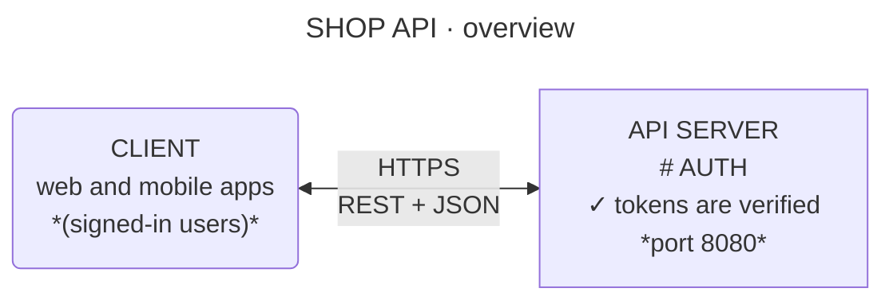

# Syntax reference

tui-mermaid-diagram supports two Mermaid diagram types: [`flowchart` / `graph`](#flowchart), where the layout is automatic, and [`block-beta`](#block-beta), where you place the blocks yourself. Anything it can't parse is skipped with a warning on stderr.

- [Flowchart](#flowchart)
- [Labels and markup](#labels-and-markup)
- [Colors](#colors)
- [block-beta](#block-beta)
- [Official Mermaid examples](#official-mermaid-examples)

## Flowchart

- Header: `flowchart` or `graph` (also `flowchart-elk`), with direction `TB` `TD` `BT` `LR` `RL`
- Node shapes: `[rect]` `(round)` `([stadium])` `((circle))` `{diamond}` `{{hexagon}}` `[(cylinder)]` `[[subroutine]]` `[/parallelogram/]` `>asymmetric]`
- v11 shapes: `id@{ shape: cyl, label: "Main DB" }`. Shapes a terminal can't draw (`docs`, `procs`, `manual-input`, …) fall back to the nearest shape or a rectangle
- Node ids may contain `-`, as in `my-node` (`--` and `-.` always start a link)
- Links: `-->` `---` `-.->` `==>` `--o` `--x` `<-->` `~~~` (invisible)
- Link labels: `-->|text|` or `-- text -->`
- Chains and groups: `A --> B --> C`, `A & B --> C`
- Edge ids: `A e1@--> B` (the id and `e1@{ animate: true }` are accepted and ignored)
- `subgraph` (nestable) is drawn as a dashed frame. An edge to a subgraph connects to a node inside it
- `direction` inside a subgraph and `click` are accepted and ignored

## Labels and markup

- Multi-line labels (`<br>`) put the first line on the box's top border as a title, and the rest in the body. `--no-titles` turns this off
- Body markup: `# heading` (bold, in the box color), `*note*` (gray), `**strong**` (bold), and a leading `✓` / `✕` (green / red)
- Entities such as `&nbsp;` `#quot;` `#9829;`, Markdown strings (`` "`text`" ``), and Font Awesome icons (`fa:fa-car`, removed)
- Edge labels sit beside the line. A two-line label (`|"above<br>below"|`) is split above and below the line; when there's no room, the label goes on top of the line
- Front matter `title:` (or `accTitle:`) is centered above the diagram; `accDescr:` is shown below it as a note
- CJK characters and emoji take two cells



```text
                      SHOP API  ·  overview

╭─ CLIENT ────────────╮                 ┌─ API SERVER ──────────┐
│ web and mobile apps │      HTTPS      │ AUTH                  │
│ (signed-in users)   │◀───────────────▶│ ✓ tokens are verified │
╰─────────────────────╯   REST + JSON   │ port 8080             │
                                        └───────────────────────┘

Only the API server talks to the database.
```

## Colors

`classDef` / `class` / `:::class` / `style` / `linkStyle` apply `stroke`, `fill` and `color` (`#rgb` or `#rrggbb`) to lines and text.

Without a style, the color follows the shape: rectangle = blue, round = green, diamond = yellow, cylinder = purple, subroutine = cyan.

## block-beta

A `flowchart` is laid out automatically. For a hand-drawn look, use `block-beta`: you place the blocks on a grid, and only the connectors are routed.

```mermaid
block-beta
    columns 3
    block:edge["EDGE"]
        cdn("CDN<br>caches static assets")
    end
    block:app["APP"]
        columns 1
        api["API<br>checks sign-in"]
        worker["WORKER<br>runs slow jobs"]
    end
    db[("DATABASE<br>Postgres")]

    cdn -->|"HTTPS<br>pages, API"| api
    worker -->|jobs| api
    api --> db
```

```text
┌╌ EDGE ╌╌╌╌╌╌╌╌╌╌╌╌╌╌╌╌╌╌╌╌╌┐                ┌╌ APP ╌╌╌╌╌╌╌╌╌╌╌╌╌╌╌╌┐        ╭─ DATABASE ─╮
╎                            ╎                ╎                      ╎        ├────────────┤
╎  ╭─ CDN ────────────────╮  ╎     HTTPS      ╎  ┌─ API ──────────┐  ╎ ╭─────▶│ Postgres   │
╎  │ caches static assets │─────────────────────▶│ checks sign-in │────╯      ╰────────────╯
╎  ╰──────────────────────╯  ╎   pages, API   ╎  └────────────────┘  ╎
╎                            ╎                ╎          ▲           ╎
╎                            ╎                ╎          │           ╎
╎                            ╎                ╎          │ jobs      ╎
╎                            ╎                ╎          │           ╎
╎                            ╎                ╎  ┌─ WORKER ───────┐  ╎
╎                            ╎                ╎  │ runs slow jobs │  ╎
╎                            ╎                ╎  └────────────────┘  ╎
╎                            ╎                ╎                      ╎
└╌╌╌╌╌╌╌╌╌╌╌╌╌╌╌╌╌╌╌╌╌╌╌╌╌╌╌╌┘                └╌╌╌╌╌╌╌╌╌╌╌╌╌╌╌╌╌╌╌╌╌╌┘
```

- `columns N` sets the number of columns. Blocks fill rows left to right and wrap when a row is full. Without `columns`, everything goes on one row
- `id:2` makes a block two columns wide. `space` / `space:2` leaves empty cells
- `block:id["Title"]:width ... end` is a dashed frame with a title, and can set its own `columns` (nestable). A `block ... end` with no id or title draws no frame and only groups its children
- Blocks in a row share a height; blocks in a column share a width
- Connectors take the clearest path (straight, one bend, a Z through a gap, or around the outside), whichever overlaps other boxes and lines least. Column and row gaps grow to fit edge labels
- `style <group id> stroke:#hex` colors a frame's title
- Block arrows `id<["label"]>(down)` (`right` `left` `up` `down` `x` `y`) are drawn as heavy arrows
- An edge to a group's id (`group --> node`) starts at the group's frame

## Official Mermaid examples

Every [official Mermaid example](https://mermaid.js.org/syntax/all-examples.html) for the supported diagram types renders without warnings. They are kept in [examples/mermaid-docs](../examples/mermaid-docs) and checked by the tests.

| Example | Status |
| --- | --- |
| Flowchart: Basic Flowchart | ✓ |
| Flowchart: Online Checkout Flow | ✓ (`style` colors applied) |
| Flowchart: CI/CD Pipeline with Subgraphs | ✓ |
| Flowchart: Expanded Node Shapes (`@{ shape }`) | ✓ (`docs`, `procs`, `manual-input` drawn as rectangles) |
| Block Diagram: Three-Tier Web Architecture | ✓ |
| Block Diagram: Block Arrows and Nested Blocks | ✓ |
| Sequence, class, state, ER, Gantt and other types | Not supported (exits with an error) |
